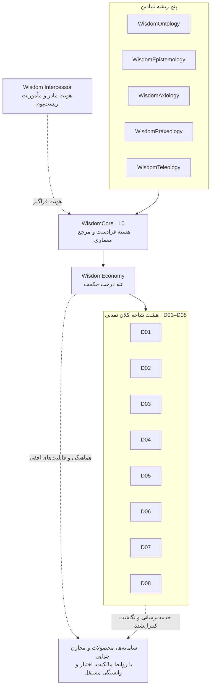

# حکمت شفیع | Wisdom Intercessor

**حکمت برای همه، همه برای حکمت جاویدان**  
*Wisdom for all; all for eternal wisdom.*

**Wisdom Intercessor** هویت مادر، مأموریت و چارچوب راهبردی زیست‌بوم حکمت است؛ زیست‌بومی انسان‌محور برای پیوند انسان، جهان ساخته و جهان بیرونی. چشم‌انداز بلندمدت آن شکل‌دهی به **آرمان‌شهر حکمت (Wisdom Utopia)** و تمدنی خردمحور، مسئولانه و پایدار است.

- **درگاه و هویت مادر:** [wisdomintercessor.com](https://wisdomintercessor.com)
- **مرجع معماری و لایه صفر:** [WisdomCore](https://github.com/Wisdom-Intercessor/WisdomCore)
- **تنه درخت حکمت:** [WisdomEconomy](https://github.com/Wisdom-Intercessor/WisdomEconomy)
- **درگاه سرزمین خرد و تجربه یکپارچه:** [WisdomLand](https://github.com/Wisdom-Intercessor/WisdomLand)
- **سه قلمرو تجربه:** **Wis · Dom · Land**
- **ساختار درخت:** پنج ریشه بنیادین ← WisdomCore (L0) ← WisdomEconomy (تنه) ← هشت شاخه کلان تمدنی (D01–D08)

> این صفحه نمای عمومی و خلاصه معماری است. اسناد کنترل‌شده WisdomCore مرجع جزئیات، تصمیم‌ها، نسخه‌ها و وضعیت تصویب‌اند. هر مورد پیشنهادی یا در حال بررسی باید با همین وضعیت معرفی شود.

---

## 1. معماری کلان و مرزبندی مفاهیم

برای جلوگیری از اختلاط مفاهیم، معماری زیست‌بوم پنج سطح متمایز دارد:

1. **هویت و مأموریت:** Wisdom Intercessor هویت مادر و مأموریت کل زیست‌بوم است؛ نه تنه درخت و نه یکی از قلمروها.
2. **ریشه‌ها و هسته:** پنج ریشه فلسفی/روش‌شناختی بنیان‌های فکری را فراهم می‌کنند؛ WisdomCore هسته فرادست (L0) و مرجع معماری، استانداردها، رجیستری‌ها و کنترل تغییر است.
3. **تنه:** WisdomEconomy تنه پیونددهنده ریشه‌ها و هسته به شاخه‌های کلان است؛ هماهنگی اقتصادی میان‌دامنه‌ای و سبد قابلیت‌ها و محصولات افقی اقتصادی را سامان می‌دهد.
4. **شاخه‌های کلان تمدنی:** هشت دامنه کلان با شناسه‌های D01–D08، حوزه‌های مسئله و مسئولیت تمدنی را دسته‌بندی می‌کنند. نام‌ها، مرزها و نگاشت نهایی آن‌ها هنوز نیازمند شواهد و تصویب کنترل‌شده است.
5. **سامانه‌ها و محصولات اجرایی:** سامانه‌های عملیاتی، محصولات، خدمات و مخازن نرم‌افزاری ابزار تحقق قابلیت‌ها هستند؛ آن‌ها با شاخه‌های D01–D08 یکی نیستند و می‌توانند با قراردادهای روشن به چند دامنه خدمت کنند.

### نمای مفهومی درخت حکمت

**وضعیت D01–D08:** این شناسه‌ها چارچوب هشت شاخه کلان تمدنی را نشان می‌دهند، نه طبقه‌بندی نهایی. نام‌گذاری، مرزها و نگاشت‌ها تا تکمیل بررسی شواهد، هم‌پوشانی‌ها و شکاف‌ها و تصویب کنترل‌شده، پیشنهادی/در حال بررسی باقی می‌مانند.

## 2. پنج ریشه بنیادین | Foundational Roots

| ریشه | مخزن | مسئولیت بنیادین |
|---|---|---|
| **هستی‌شناسی · Ontology** | [WisdomOntology](https://github.com/Wisdom-Intercessor/WisdomOntology) | هستی‌ها، مفاهیم، موجودیت‌ها، روابط و طبقه‌بندی‌ها |
| **معرفت‌شناسی · Epistemology** | [WisdomEpistemology](https://github.com/Wisdom-Intercessor/WisdomEpistemology) | دانش، ادعا، شواهد، منشأ، روش، عدم‌قطعیت و اصلاح |
| **ارزش‌شناسی · Axiology** | [WisdomAxiology](https://github.com/Wisdom-Intercessor/WisdomAxiology) | ارزش‌ها، اخلاق، کرامت، حقوق، عدالت و مسئولیت |
| **کنش‌شناسی · Praxeology** | [WisdomPraxeology](https://github.com/Wisdom-Intercessor/WisdomPraxeology) | کنش، گزینه‌ها، تصمیم، اختیار، برنامه، اجرا و بازخورد |
| **غایت‌شناسی · Teleology** | [WisdomTeleology](https://github.com/Wisdom-Intercessor/WisdomTeleology) | هدف، غایت، مأموریت، چشم‌انداز و جهت |

این ریشه‌ها بنیان‌های مکمل‌اند؛ هیچ‌یک به‌تنهایی مالک همه تصمیم‌ها یا داده‌های عملیاتی نیستند.

## 3. WisdomCore و WisdomEconomy

### WisdomCore — Layer 0

**WisdomCore** هسته فرادست و مرجع معماری مادر است. مسئولیت آن شامل اصول و استانداردهای مشترک، مدل‌ها و رجیستری‌ها، تصمیم‌های معماری، کنترل نسخه و تغییر، ردیابی وابستگی‌ها و حفظ انسجام میان قلمروها، شاخه‌ها و سامانه‌هاست. WisdomCore جایگزین اختیار عملیاتی سامانه‌های تخصصی نیست و مخزن مرکزی تمام داده‌های عملیاتی محسوب نمی‌شود.

### WisdomEconomy — تنه درخت حکمت

**WisdomEconomy تنه درخت حکمت است.** این تنه ریشه‌ها و هسته را به هشت شاخه کلان پیوند می‌دهد و هماهنگی اقتصادی و منابعی میان دامنه‌ها را سامان می‌دهد. حوزه مسئولیت آن عبارت است از:

- معماری و اصول اقتصاد حکمت؛
- هماهنگی جریان‌های ارزش و منابع میان دامنه‌ها؛
- سبد محصولات و قابلیت‌های افقی اقتصادی؛
- قراردادها و رابط‌های اقتصادی میان سامانه‌ها؛
- شفافیت، پاسخ‌گویی، حسابداری‌پذیری و ارزیابی ریسک؛
- کاهش جزیره‌ای‌شدن و تکرار غیرضروری زیرساخت‌ها.

WisdomEconomy جایگزین WisdomCore نیست، مرجع همه تصمیم‌های معماری نمی‌شود، مالک تمام داده‌های شاخه‌ها نیست و به‌معنای تجمیع بی‌قید اطلاعات یا تمرکز همه عملیات در یک سامانه نیست. هر سامانه مبدأ، اختیار عملیاتی و مرجعیت داده‌های خود را طبق قراردادها و قواعد مصوب حفظ می‌کند.

### رابطه WeCoin، WisdomChain و WisdomTreasury

- **WeCoin:** در استعاره درخت، شیره و ثمره تنه WisdomEconomy و عضوی از سبد محصولات آن است.
- **WisdomChain (L2):** زیرساخت فنی و رابطه پروتکلی WeCoin؛ رابطه فنی آن با رابطه سبد محصولی WeCoin در WisdomEconomy متفاوت است.
- **WisdomTreasury:** سامانه تخصصی خزانه‌داری، حسابداری، تخصیص و امانت‌داری منابع؛ از طریق رابط‌های مشخص با سایر اجزا تعامل می‌کند و والد یا مالک WeCoin نیست.

این جایگاه‌ها معماری و مستندسازی‌اند و به‌خودی‌خود صدور توکن، کیف پول، پرداخت، معامله، پاداش یا عملیات خزانه‌داری را فعال نمی‌کنند.

## 4. هشت شاخه کلان در برابر هشت خانواده سامانه عملیاتی

دو مجموعه هشت‌تایی زیر از نظر ماهیت متفاوت‌اند و نباید با هم خلط شوند:

- **D01–D08:** هشت شاخه کلان تمدنی؛ طبقه‌بندی حوزه‌های مسئله، مسئولیت و حکمرانی. نام‌ها و نگاشت نهایی هنوز قطعی نیستند.
- **L1–L8:** هشت خانواده سامانه عملیاتی ثبت‌شده؛ دسته‌بندی زیرساخت‌ها و سامانه‌های اجرایی. این شناسه‌ها تعریف شاخه‌های D01–D08 نیستند.

| شناسه عملیاتی | خانواده سامانه | مخزن مرجع |
|---|---|---|
| L1 | WisdomNetwork | [Wisdom-Network](https://github.com/Wisdom-Intercessor/Wisdom-Network) |
| L2 | WisdomChain | [WisdomChain](https://github.com/Wisdom-Intercessor/WisdomChain) |
| L3 | WisdomTreasury | [Wisdom-Treasury](https://github.com/Wisdom-Intercessor/Wisdom-Treasury) |
| L4 | WisdomKnowledge | [Wisdom-Knowledge](https://github.com/Wisdom-Intercessor/Wisdom-Knowledge) |
| L5 | WisdomGuard | [Wisdom-Guard](https://github.com/Wisdom-Intercessor/Wisdom-Guard) |
| L6 | WisdomGovernance & Justice | [Wisdom-Governance-Justice](https://github.com/Wisdom-Intercessor/Wisdom-Governance-Justice) |
| L7 | WisdomLife & Health | [WisdomLife-Health](https://github.com/Wisdom-Intercessor/WisdomLife-Health) |
| L8 | Wisdom of Existence & Time | [Wisdom-of-Existence-Time](https://github.com/Wisdom-Intercessor/Wisdom-of-Existence-Time) |

این جدول فهرست خانواده‌های سامانه‌ای است؛ نه تأیید استقرار یا آمادگی عملیاتی تمام قابلیت‌ها. یک سامانه یا محصول می‌تواند در چند دامنه D01–D08 نقش داشته باشد. نوع رابطه، مرجع تصمیم، مالکیت محصول، اختیار عملیاتی، مرجع داده و متولی داده باید جداگانه در رجیستری ثبت شوند.

## 5. سه قلمرو تجربه | Wis · Dom · Land

| قلمرو | معنا | دامنه تجربه |
|---|---|---|
| **Wis — عالِم صغری** | انسان خردمند | انسان، هویت، خرد، یادگیری، ارزش‌ها، اختیار، زندگی و خودحکمرانی |
| **Dom — عَـالَم صغری** | جهان ساخته و پیوندی انسان | روابط، جامعه، نهادها، اقتصاد، فناوری، سامانه‌ها و حکمرانی؛ در مقیاس ملی و جهانی |
| **Land — عالَم کبری** | جهان بیرونی و بزرگ‌تر | ماده، طبیعت، زیست‌بوم‌ها، زمین، سیاره‌ها، ستارگان، کهکشان‌ها و کیهان |

**WisDomLand** تجربه یکپارچه و پیوند سه قلمرو است؛ قلمرو چهارم، شاخه نهم یا جایگزین Wisdom Intercessor نیست. **WisdomLand / سرزمین خرد** درگاه مادر و نقطه ورود به تجربه سه قلمرو است؛ نام کامل درگاه را نباید با برچسب کوتاه قلمرو **Land** یکی دانست.

- [Wisdom Intercessor](https://wisdomintercessor.com) — هویت مادر و درگاه اصلی زیست‌بوم.
- [WisdomLand](https://github.com/Wisdom-Intercessor/WisdomLand) — معماری درگاه و تجربه یکپارچه سه قلمرو.

## 6. قابلیت‌های افقی، هویت و هوشمندی

قابلیت افقی می‌تواند در چند قلمرو، شاخه یا سامانه مصرف شود؛ اما مصرف مشترک به‌معنای انتقال خودکار مالکیت، اختیار یا داده محصول تخصصی نیست.

- **WisdomID:** چارچوب هویت و دسترسی مشترک با حداقل‌سازی داده و مجوزهای لازم.
- **WisdomAI و عامل‌های هوشمند:** قابلیت‌های هوشمندی با دامنه اختیار محدود، منشأ قابل ردیابی و نظارت انسانی متناسب؛ جایگاه فنی و مالکیت هر جزء باید در رجیستری مشخص باشد.
- **WisdomBridge / WisdomInterop / WisdomStandards:** اتصال، تعامل‌پذیری و استانداردهای مشترک.
- **WisdomStorage / WisdomOracle / WisdomAnalytics:** ذخیره‌سازی، داده و تحلیل با کنترل دسترسی، منشأ و محدودیت هدف.

سامانه مبدأ مرجع داده عملیاتی خود باقی می‌ماند. دسترسی میان‌سامانه‌ای فقط بر اساس هدف مشخص، حداقل داده ضروری، مجوز معتبر و قرارداد نسخه‌بندی‌شده انجام می‌شود.

## 7. حکمرانی، مشارکت و وضعیت بلوغ

چرخه حکمرانی مشارکتی به‌صورت مرحله‌ای طراحی می‌شود: **پیشنهاد ← بررسی شواهد و متخصصان ← گفت‌وگو ← سنجش آمادگی ← همه‌پرسی در صورت اقتضا ← جمع‌بندی ← تصویب مرجع صلاحیت‌دار ← پیگیری اجرا**.

- هوش مصنوعی می‌تواند شواهد را گردآوری و تحلیل کند، اما نمی‌تواند بازبینی انسانی، رأی یا تصویب جامعه را جعل کند.
- بررسی تخصصی، گفت‌وگو، همه‌پرسی، جمع‌بندی، تصویب و اجرا مراحل متمایزند.
- پاداش احتمالی فقط می‌تواند به کار و مشارکت قابل ارزیابی و بی‌طرفانه مربوط باشد، نه جهت رأی یا نتیجه آن.
- اطلاعات هویتی، رأی، مشارکت و پاداش باید از نظر دسترسی و هدف پردازش تفکیک شوند.
- همه‌پرسی به‌تنهایی اختیار قانونی یا اثر حقوقی بیرونی ایجاد نمی‌کند.

مفهوم، پیشنهاد، سند، نمونه اولیه، قابلیت آزمایشی، محصول تأییدشده و خدمت عملیاتی باید با وضعیت‌های جداگانه معرفی شوند. وجود مخزن یا سند به‌معنای پیاده‌سازی، انتشار، ممیزی امنیتی، مجوز قانونی یا آماده‌به‌کاری نیست. هر تغییر در دامنه، DNS، میزبانی، وب‌سایت، انتشار عمومی، انتقال مخزن، صدور دارایی یا عملیات مالی به مجوز مستقل نیاز دارد.

## 8. نقشه مخازن و مراجع

- [WisdomCore](https://github.com/Wisdom-Intercessor/WisdomCore) — معماری مادر، L0، رجیستری‌ها و تصمیم‌ها.
- [WisdomEconomy](https://github.com/Wisdom-Intercessor/WisdomEconomy) — تنه درخت و سبد اقتصادی افقی.
- [WisdomChain](https://github.com/Wisdom-Intercessor/WisdomChain) — زیرساخت فنی L2.
- [WeCoin](https://github.com/Wisdom-Intercessor/WeCoin) — اسناد و معماری محصول WeCoin.
- [Wisdom-Treasury](https://github.com/Wisdom-Intercessor/Wisdom-Treasury) — سامانه تخصصی خزانه‌داری.
- [WisdomLand](https://github.com/Wisdom-Intercessor/WisdomLand) — درگاه و تجربه یکپارچه سه قلمرو.
- [WisdomPact](https://github.com/Wisdom-Intercessor/WisdomPact) — پیمان و اصول بنیادین.
- [Wisdom-Iran](https://github.com/Wisdom-Intercessor/Wisdom-Iran) — چارچوب و برنامه ملی ایران.

این فهرست نقطه شروع است، نه فهرست کامل همه مخازن. رجیستری WisdomCore مرجع طبقه‌بندی، روابط، مسئولیت‌ها، وضعیت و مقصد مخازن است.

## 9. English overview

**Wisdom Intercessor** is the parent identity and mission of a human-centered wisdom ecosystem. Its conceptual Wisdom Tree has **five foundational roots, WisdomCore as the Layer 0 meta-architectural core, WisdomEconomy as the connecting trunk, and eight civilizational macro-branches (D01–D08)**. The D01–D08 taxonomy remains provisional until evidence review and controlled approval.

The eight civilizational macro-branches are distinct from the **eight operational system families (L1–L8)** and their repositories. Operational systems and products may serve multiple macro-domains under explicit ownership, authority, data-governance and interface contracts.

**WisdomEconomy is the trunk** and coordinates cross-domain economic architecture and the horizontal economic portfolio. **WeCoin is conceptually the sap and fruit of this trunk**, while its technical relationship remains with **WisdomChain L2**. **WisdomTreasury** is a specialized treasury/accounting subsystem, not WeCoin's parent.

The three experience realms are **Wis** (the wise human), **Dom** (the human-created and connective world, at National and Global scales), and **Land** (the greater external world). **WisdomLand** is the mother gateway; **WisDomLand** is the integrated three-realm experience, not a fourth realm.

Architecture, implementation maturity and operational status are tracked separately. This profile does not authorize production deployment, financial activity, token issuance or changes to repositories, domains or services.

---

**Wisdom Intercessor · حکمت شفیع**  
*Wisdom for all; all for eternal wisdom.*
