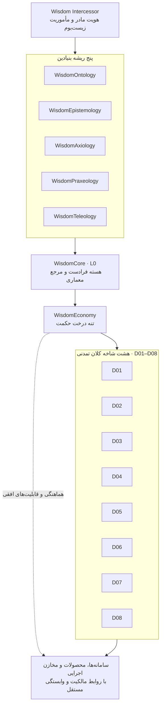

# حکمت شفیع | Wisdom Intercessor

**حکمت برای همه، همه برای حکمت جاویدان**  
*Wisdom for all; all for eternal wisdom.*

**Wisdom Intercessor** هویت مادر، مأموریت و چارچوب راهبردی زیست‌بوم حکمت است؛ چشم‌اندازی انسان‌محور برای پیوند انسان، جهان ساخته و پیوندی انسان، و جهان بزرگ‌تر هستی. مقصد بلندمدت آن شکل‌دادن به **آرمان‌شهر حکمت (Wisdom Utopia)** و تمدنی خردمحور، مسئولانه و پایدار است.

- **درگاه و هویت مادر:** [wisdomintercessor.com](https://wisdomintercessor.com)
- **مرجع معماری و لایه صفر:** [WisdomCore](https://github.com/Wisdom-Intercessor/WisdomCore)
- **تنه درخت حکمت:** [WisdomEconomy](https://github.com/Wisdom-Intercessor/WisdomEconomy)
- **درگاه و تجربه یکپارچه سه قلمرو:** [WisdomLand](https://github.com/Wisdom-Intercessor/WisdomLand)
- **تجربه سه‌گانه:** **Wis · Dom · Land** (WisDomLand)
- **ساختار مفهومی درخت:** پنج ریشه بنیادین + هسته WisdomCore (L0) + تنه WisdomEconomy + هشت شاخه کلان

---

## 1. هویت و معماری کلان

معماری Wisdom Intercessor بر تفکیک هویت، معماری، قلمرو، دامنه‌های تمدنی، سامانه‌های اجرایی و محصولات استوار است:

1. **Wisdom Intercessor** هویت مادر و مأموریت زیست‌بوم است؛ نه تنه درخت.
2. **WisdomCore (L0)** هسته فرادست و مرجع معماری، استانداردها، رجیستری‌ها، تصمیم‌های معماری و انسجام میان اجزاست.
3. **پنج ریشه بنیادین** مبانی هستی‌شناختی، معرفت‌شناختی، ارزش‌شناختی، کنش‌شناختی و غایت‌شناختی را فراهم می‌کنند.
4. **WisdomEconomy** تنه درخت حکمت است؛ ریشه‌ها و هسته را به شاخه‌ها پیوند می‌دهد و هماهنگی اقتصادی میان‌دامنه‌ای و سبد قابلیت‌ها و محصولات افقی اقتصادی را سامان می‌دهد.
5. **هشت شاخه کلان** مسائل و حوزه‌های تمدنی را سازمان می‌دهند؛ این شاخه‌ها با سامانه‌ها، لایه‌های اجرایی یا مخازن GitHub یکی نیستند.
6. **سامانه‌ها و محصولات اجرایی** ابزارهای تحقق مأموریت‌اند و از طریق رجیستری و روابط کنترل‌شده به یک یا چند دامنه خدمت می‌کنند.
7. **Wis · Dom · Land** سه قلمرو/زمینه تجربه‌اند و معماری را از منظر انسان، جهان ساخته و جهان بیرونی قابل پیمایش می‌کنند.

### نمای مفهومی درخت حکمت

**یادداشت وضعیت:** D01–D08 شناسه‌های دامنه‌های کلان در چارچوب طبقه‌بندی تمدنی‌اند. نام‌گذاری نهایی، مرزها و نگاشت قطعی آن‌ها تابع تکمیل شواهد، بررسی هم‌پوشانی و شکاف‌ها و تصویب کنترل‌شده است. این نمودار به‌معنای نهایی‌شدن طبقه‌بندی یا استقرار سامانه‌ها نیست.

## 2. پنج ریشه بنیادین | Foundational Roots

| ریشه | مخزن | مسئولیت بنیادین |
|---|---|---|
| **هستی‌شناسی · Ontology** | [WisdomOntology](https://github.com/Wisdom-Intercessor/WisdomOntology) | هستی‌ها، مفاهیم، موجودیت‌ها، روابط و طبقه‌بندی‌ها |
| **معرفت‌شناسی · Epistemology** | [WisdomEpistemology](https://github.com/Wisdom-Intercessor/WisdomEpistemology) | دانش، ادعا، شواهد، منشأ، روش، عدم‌قطعیت و اصلاح |
| **ارزش‌شناسی · Axiology** | [WisdomAxiology](https://github.com/Wisdom-Intercessor/WisdomAxiology) | ارزش‌ها، اخلاق، کرامت، حقوق، عدالت و مسئولیت |
| **کنش‌شناسی · Praxeology** | [WisdomPraxeology](https://github.com/Wisdom-Intercessor/WisdomPraxeology) | کنش، گزینه‌ها، تصمیم، اختیار، برنامه، اجرا و بازخورد |
| **غایت‌شناسی · Teleology** | [WisdomTeleology](https://github.com/Wisdom-Intercessor/WisdomTeleology) | هدف، غایت، مأموریت، چشم‌انداز و جهت |

این پنج ریشه مکمل‌اند؛ هیچ‌کدام به‌تنهایی مالک تمام تصمیم‌ها یا داده‌های عملیاتی نیستند.

## 3. هسته فرادست و تنه درخت

### WisdomCore — Layer 0

WisdomCore مرجع معماری مادر، اصول و استانداردهای مشترک، رجیستری دامنه‌ها و محصولات، تصمیم‌های معماری، کنترل نسخه، مرزبندی مسئولیت‌ها و ردیابی وابستگی‌هاست. WisdomCore مالک یا مخزن مرکزی تمام داده‌های عملیاتی محصولات نیست و جایگزین اختیار اجرایی سامانه‌های تخصصی نمی‌شود.

### WisdomEconomy — تنه درخت حکمت

WisdomEconomy تنه پیونددهنده درخت است؛ ریشه‌ها و هسته را به شاخه‌ها متصل می‌کند و هماهنگی اقتصادی و منابعی را در سطح کل زیست‌بوم سامان می‌دهد. مسئولیت‌های آن:
- معماری و اصول اقتصاد حکمت؛
- هماهنگی جریان‌های ارزش و منابع میان دامنه‌ها؛
- خانه سبد محصولات و قابلیت‌های افقی اقتصادی؛
- تعریف رابط‌ها و قراردادهای اقتصادی میان سامانه‌ها؛
- شفافیت، پاسخ‌گویی، حسابداری‌پذیری و ارزیابی ریسک اقتصادی؛
- جلوگیری از جزیره‌ای‌شدن محصولات و تکرار زیرساخت‌ها.

WisdomEconomy جایگزین WisdomCore نیست، مالک همه داده‌های شاخه‌ها نمی‌شود و به‌معنای تجمیع بی‌قید اطلاعات یا تمرکز تمام عملیات در یک سامانه نیست.

### رابطه WeCoin، WisdomChain و WisdomTreasury

- **WeCoin:** شیره و ثمره تنه WisdomEconomy در استعاره درخت؛ محصولی در سبد WisdomEconomy.
- **WisdomChain (L2):** جایگاه فنی و زیرساخت پروتکلی WeCoin؛ رابطه فنی با رابطه سبد محصولی متفاوت است.
- **WisdomTreasury:** سامانه تخصصی خزانه‌داری، حسابداری، تخصیص و امانت‌داری منابع؛ شریک یکپارچه‌سازی مشخص است، نه مالک یا والد WeCoin.

این جایگاه‌ها معماری و مستندسازی‌اند و به‌خودی‌خود صدور توکن، کیف پول، پرداخت، معامله، پاداش یا عملیات خزانه‌داری را فعال نمی‌کنند.

## 4. هشت شاخه کلان و سامانه‌های اجرایی

هشت شاخه کلان درخت، دامنه‌های مسئله و حکمرانی تمدنی را دسته‌بندی می‌کنند. سامانه‌های عملیاتی مانند WisdomNetwork، WisdomChain و WisdomKnowledge ابزارها و زیرساخت‌های اجرایی‌اند. این دو طبقه نباید با یکدیگر خلط شوند.

**قواعد طبقه‌بندی:**
- تعداد شاخه‌های کلان در مدل هدف هشت است؛ ایجاد شاخه نهم یا تغییر تعداد بدون تصمیم معماری کنترل‌شده مجاز نیست.
- شناسه‌های D01–D08 برای دامنه‌های کلان به‌کار می‌روند؛ L0 برای WisdomCore محفوظ است.
- سامانه یا محصول می‌تواند به چند دامنه خدمت کند؛ این امر به‌معنای ایجاد شاخه جدید یا مالکیت مشترک مبهم نیست.
- نگاشت هر سامانه به دامنه‌ها باید در رجیستری با نوع رابطه، شواهد و وضعیت اعتبار ثبت شود.
- اسناد قدیمی که L1–L8 را برای هشت سامانه عملیاتی به‌کار برده‌اند، اسناد سامانه‌ای‌اند و نباید به‌عنوان تعریف خودکار هشت شاخه کلان تفسیر شوند.

### سبد سامانه‌های عملیاتی ثبت‌شده

| سامانه | مخزن مرجع | نقش اجرایی |
|---|---|---|
| **WisdomNetwork** | [Wisdom-Network](https://github.com/Wisdom-Intercessor/Wisdom-Network) | شبکه، ارتباطات، رسانه و مشارکت |
| **WisdomChain** | [WisdomChain](https://github.com/Wisdom-Intercessor/WisdomChain) | اعتماد، ثبت و زیرساخت پروتکلی |
| **WisdomTreasury** | [Wisdom-Treasury](https://github.com/Wisdom-Intercessor/Wisdom-Treasury) | خزانه‌داری، حسابداری و تخصیص منابع |
| **WisdomKnowledge** | [Wisdom-Knowledge](https://github.com/Wisdom-Intercessor/Wisdom-Knowledge) | دانش، پژوهش، آموزش و یادگیری؛ میزبان معماری WisdomAI |
| **WisdomGuard** | [Wisdom-Guard](https://github.com/Wisdom-Intercessor/Wisdom-Guard) | امنیت، حفاظت و تاب‌آوری |
| **WisdomGovernance & Justice** | [Wisdom-Governance-Justice](https://github.com/Wisdom-Intercessor/Wisdom-Governance-Justice) | حکمرانی، عدالت، قواعد و پاسخ‌گویی |
| **WisdomLife & Health** | [WisdomLife-Health](https://github.com/Wisdom-Intercessor/WisdomLife-Health) | زندگی، سلامت و بهزیستی |
| **Wisdom of Existence & Time** | [Wisdom-of-Existence-Time](https://github.com/Wisdom-Intercessor/Wisdom-of-Existence-Time) | وجود، زمان و شناخت جهان |

این جدول فهرست سامانه‌های ثبت‌شده است، نه تعریف شاخه‌های D01–D08 و نه گواه استقرار یا آمادگی عملیاتی همه قابلیت‌ها.

## 5. سه قلمرو تجربه | Wis · Dom · Land

| قلمرو | معنا | دامنه تجربه |
|---|---|---|
| **Wis — عالِم صغری** | انسان خردمند | انسان، هویت، خرد، یادگیری، ارزش‌ها، اختیار، زندگی و خودحکمرانی |
| **Dom — عَـالَم صغری** | جهان ساخته و پیوندی انسان | روابط، جامعه، نهادها، اقتصاد، فناوری، سامانه‌ها و حکمرانی؛ در مقیاس ملی و جهانی |
| **Land — عالَم کبری** | جهان بیرونی و بزرگ‌تر | ماده، طبیعت، زیست‌بوم‌ها، زمین، سیاره‌ها، ستارگان، کهکشان‌ها و کیهان |

**WisDomLand** تجربه یکپارچه و پیوند سه قلمرو است؛ قلمرو چهارم یا شاخه نهم نیست. **WisdomLand** نام درگاه/چشم‌انداز کلان سرزمین خرد است و نباید با برچسب کوتاه صفحه **Land** اشتباه شود.

- [Wisdom Intercessor](https://wisdomintercessor.com) — هویت مادر و درگاه اصلی زیست‌بوم.
- [WisdomLand](https://github.com/Wisdom-Intercessor/WisdomLand) — معماری درگاه و تجربه یکپارچه سه قلمرو.
- **wisdomland.ir** — مسیر ملی WisdomLand؛ انتشار و بهره‌برداری تابع تأیید مستقل است.
- **wisdomland.com** — هدف بین‌المللی آینده؛ فعال‌بودن آن در این صفحه ادعا نمی‌شود.
- **Wisland / wisland.ir** — پروژه‌ای مستقل؛ جزئی از WisdomLand یا تنه WisdomEconomy نیست.

## 6. سبد افقی، هویت و هوشمندی

قابلیت‌های افقی می‌توانند در چند دامنه و قلمرو استفاده شوند، اما مصرف افقی به‌معنای انتقال مالکیت یا داده محصول تخصصی نیست.

- **WisdomID:** هویت و دسترسی مشترک با حداقل‌سازی ویژگی‌ها و مجوزهای لازم.
- **WisdomAI:** زیرسامانه هوشمندی در معماری WisdomKnowledge؛ قابلیت‌های آن فقط از طریق قرارداد و مجوز مشخص در اختیار سایر سامانه‌ها قرار می‌گیرند.
- **WisdomAgents / WisdomCopilot / WisdomMini:** قابلیت‌ها یا چارچوب‌های هوشمند با اختیار محدود و قابل حسابرسی؛ جایگاه نهایی هرکدام تابع رجیستری است.
- **WisdomBridge / WisdomInterop / WisdomStandards:** اتصال، تعامل‌پذیری و استانداردهای مشترک.
- **WisdomStorage / WisdomOracle / WisdomAnalytics:** زیرساخت ذخیره‌سازی، داده و تحلیل با منشأ، کنترل دسترسی و محدودیت هدف.

سامانه مبدأ، مرجع داده عملیاتی خود باقی می‌ماند. WisdomEconomy و قابلیت‌های افقی فقط داده ضروری و مجاز را از طریق قراردادهای نسخه‌بندی‌شده دریافت می‌کنند.

## 7. حکمرانی، مشارکت و بلوغ

چرخه حکمرانی مشارکتی به‌صورت مرحله‌ای طراحی می‌شود: **پیشنهاد → بررسی شواهد و متخصصان → گفت‌وگو → سنجش آمادگی → همه‌پرسی در صورت اقتضا → جمع‌بندی → تصویب مرجع صلاحیت‌دار → پیگیری اجرا**.

- هوش مصنوعی می‌تواند شواهد را گردآوری و تحلیل کند، اما نمی‌تواند بازبینی انسانی، رأی یا تصویب جامعه را جعل کند.
- رأی‌گیری، نتیجه‌سنجی، تصویب و اجرای تصمیم چهار مرحله متمایزند.
- پاداش احتمالی برای کار و مشارکت قابل ارزیابی است، نه برای جهت رأی یا نتیجه.
- اطلاعات هویتی، رأی، مشارکت و پاداش باید از نظر دسترسی و هدف پردازش تفکیک شوند.
- هیچ همه‌پرسی به‌تنهایی اختیار قانونی یا اثر حقوقی بیرونی ایجاد نمی‌کند.
- تا زمان تصویب قواعد و فعال‌سازی رسمی، اسناد این بخش صرفاً چارچوب طراحی‌اند.

مفاهیم، اسناد، نمونه‌های اولیه، قابلیت‌های آزمایشی، محصولات تأییدشده و خدمات عملیاتی باید با وضعیت‌های جداگانه ثبت شوند. وجود مخزن یا سند به‌معنای پیاده‌سازی، انتشار، ممیزی امنیتی، مجوز قانونی یا آماده‌به‌کاری نیست. تغییر در دامنه، DNS، میزبانی، وب‌سایت، انتشار عمومی، انتقال مخزن، صدور دارایی یا عملیات مالی نیازمند مجوز مستقل و صریح است.

## 8. نقشه مخازن اصلی

- [WisdomCore](https://github.com/Wisdom-Intercessor/WisdomCore) — معماری مادر، Layer 0، رجیستری و تصمیم‌ها.
- [WisdomEconomy](https://github.com/Wisdom-Intercessor/WisdomEconomy) — تنه درخت و سبد اقتصادی افقی.
- [WisdomChain](https://github.com/Wisdom-Intercessor/WisdomChain) — زیرساخت فنی L2.
- [WeCoin](https://github.com/Wisdom-Intercessor/WeCoin) — اسناد محصول WeCoin.
- [Wisdom-Treasury](https://github.com/Wisdom-Intercessor/Wisdom-Treasury) — خزانه‌داری تخصصی.
- [WisdomLand](https://github.com/Wisdom-Intercessor/WisdomLand) — درگاه/تجربه سه قلمرو.
- [WisdomPact](https://github.com/Wisdom-Intercessor/WisdomPact) — پیمان و اصول بنیادین.
- [Wisdom-Iran](https://github.com/Wisdom-Intercessor/Wisdom-Iran) — چارچوب و برنامه ملی ایران.

این فهرست نقطه شروع است. رجیستری WisdomCore مرجع نهایی طبقه‌بندی، روابط، وضعیت و مقصد مخازن است.

## 9. English overview

**Wisdom Intercessor** is the parent identity and mission of a human-centered wisdom ecosystem. The target Wisdom Tree consists of **five foundational roots, WisdomCore as the Layer 0 meta-architectural core, WisdomEconomy as the connecting trunk, and eight civilizational macro-branches (D01–D08)**. These macro-domains are distinct from the operational systems and product repositories that implement capabilities across them.

**WisdomEconomy is the trunk**, connecting roots and core to the branches while coordinating cross-domain economic architecture and the horizontal economic portfolio. **WeCoin is the conceptual sap and fruit of the trunk**, while its technical product/runtime relationship remains with **WisdomChain L2**. **WisdomTreasury** is a specialized treasury and accounting subsystem, not WeCoin's parent.

The three experience realms are **Wis** (the wise human), **Dom** (the human-created and connective world), and **Land** (the greater external world). **WisDomLand** is their integrated experience, not a fourth realm. Architecture, implementation maturity and operational status are tracked separately.

---

**Wisdom Intercessor · حکمت شفیع**  
*Wisdom for all; all for eternal wisdom.*
