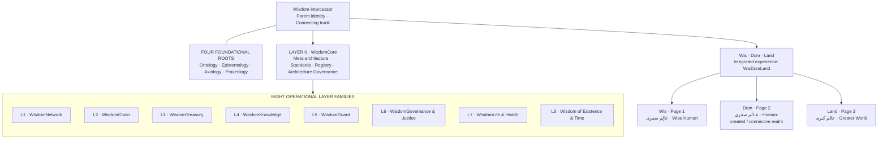

# حکمت شفیع — Wisdom Intercessor

**حکمت برای همه، همه برای حکمت جاویدان**  
*Wisdom for all; all for eternal wisdom.*

Wisdom Intercessor (حکمت شفیع) پروژه مادر، تنه پیونددهنده و زیرساخت مشترک زیست‌بوم حکمت است؛ چارچوبی انسان‌محور برای پیوند انسان خردمند، جهان ساخته و پیوندی انسان، و جهان بزرگ‌تر هستی. هدف بلندمدت، احیا یا ساختن **آرمان‌شهر حکمت (Wisdom Utopia)** و تمدنی حکمت‌محور است.

- **درگاه و پروژه مادر:** [wisdomintercessor.com](https://wisdomintercessor.com)
- **مرجع معماری و لایه صفر:** [WisdomCore](https://github.com/Wisdom-Intercessor/WisdomCore)
- **قلمرو و زیست‌بوم پیوندی:** [WisdomLand](https://github.com/Wisdom-Intercessor/WisdomLand) · [wisdomland.ir](https://wisdomland.ir) (پیاده‌سازی ملی، مشروط به تأیید و آمادگی)
- **تجربه سه‌صفحه‌ای:** **Wis · Dom · Land** — در مجموع **WisDomLand**
- **معماری:** یک لایه صفر + هشت خانواده لایه عملیاتی؛ چهار ریشه بنیادین

---

## 1. هویت و معماری کلان

Wisdom Intercessor تنه و زیرساخت پیونددهنده زیست‌بوم است. WisdomCore مرجع معماری، استانداردها، ثبت و هماهنگی در Layer 0 است. چهار ریشه بنیادین چارچوب مفهومی و روش‌شناختی را شکل می‌دهند؛ هشت خانواده لایه عملیاتی مسئولیت‌های سامانه‌ای را پوشش می‌دهند.

**اصول ساختاری:** Layer 0 با هشت خانواده عملیاتی اشتباه گرفته نمی‌شود؛ ریشه‌های بنیادین، لایه عملیاتی جدید نیستند؛ تجربه WisDomLand صفحه یا قلمرو چهارم نیست؛ و WisdomLand (نام کامل آرمان‌شهر) با برچسب صفحه Land یکی نیست.

---

## 2. چهار ریشه بنیادین | Foundational Roots

| ریشه | Repository | مسئولیت بنیادین |
|---|---|---|
| **هستی‌شناسی · Ontology** | [WisdomOntology](https://github.com/Wisdom-Intercessor/WisdomOntology) | تعریف هستی‌ها، مفاهیم، موجودیت‌ها، روابط، طبقه‌بندی‌ها و مدل جهان |
| **معرفت‌شناسی · Epistemology** | [WisdomEpistemology](https://github.com/Wisdom-Intercessor/WisdomEpistemology) | ادعا، شواهد، منشأ، اعتبار، استدلال، عدم‌قطعیت و بازنگری معرفتی |
| **ارزش‌شناسی · Axiology** | [WisdomAxiology](https://github.com/Wisdom-Intercessor/WisdomAxiology) | ارزش‌ها، اخلاق، کرامت، حقوق، عدالت، مسئولیت و ارزیابی پیامدها |
| **کنش‌شناسی / عمل‌شناسی · Praxeology** | [WisdomPraxeology](https://github.com/Wisdom-Intercessor/WisdomPraxeology) | هدف، گزینه‌ها، تصمیم، اختیار، برنامه، اقدام، نتیجه و بازخورد |

این چهار ریشه مکمل یکدیگرند و مرز مسئولیت دارند؛ هیچ‌یک به‌تنهایی مالک همه مفاهیم، ارزش‌ها، شواهد یا تصمیم‌های زیست‌بوم نیست.

---

## 3. لایه صفر و هشت خانواده عملیاتی

**Layer 0 — WisdomCore:** معماری مادر، استانداردهای مشترک، رجیستری، مرزبندی مسئولیت‌ها، وابستگی‌ها و حاکمیت تغییرات معماری.

| لایه | سامانه | حوزه مسئولیت |
|---|---|---|
| **L1** | [WisdomNetwork](https://github.com/Wisdom-Intercessor/Wisdom-Network) | ارتباطات، رسانه، اتصال، تعامل و مشارکت شبکه‌ای |
| **L2** | [WisdomChain](https://github.com/Wisdom-Intercessor/WisdomChain) | اعتماد، سوابق قابل‌راستی‌آزمایی، یکپارچگی و زیرساخت پروتکلی |
| **L3** | [WisdomTreasury](https://github.com/Wisdom-Intercessor/Wisdom-Treasury) | خزانه، امانت‌داری منابع و زیرساخت اقتصادی |
| **L4** | [WisdomKnowledge](https://github.com/Wisdom-Intercessor/WisdomKnowledge) | دانش، پژوهش، یادگیری، آموزش و هوشمندی؛ WisdomAI به‌عنوان زیرسامانه |
| **L5** | [WisdomGuard](https://github.com/Wisdom-Intercessor/Wisdom-Guard) | امنیت، حفاظت، تاب‌آوری و ایمنی |
| **L6** | [WisdomGovernance & Justice](https://github.com/Wisdom-Intercessor/Wisdom-Governance-Justice) | حکمرانی، قواعد، عدالت، پاسخ‌گویی و مشارکت |
| **L7** | [WisdomLife & Health](https://github.com/Wisdom-Intercessor/WisdomLife-Health) | زندگی، سلامت، بهزیستی و خدمات مرتبط |
| **L8** | [Wisdom of Existence & Time](https://github.com/Wisdom-Intercessor/Wisdom-of-Existence-Time) | هستی، زمان، زمین، کیهان و رابطه با جهان بزرگ‌تر |

لایه‌ها خانواده‌های مسئولیت معماری هستند؛ این فهرست به‌تنهایی اثبات‌کننده پیاده‌سازی، آمادگی عملیاتی، امنیت ممیزی‌شده یا استقرار همه قابلیت‌ها نیست.

---

## 4. سه صفحه / سه قلمرو | Wis · Dom · Land

| نام کوتاه | صفحه | معنای معماری | فضای تجربه |
|---|---|---|---|
| **Wis** | Page 1 | **عالِم صغری** — انسان خردمند | انسان، هویت، خرد، اختیار، خودحکمرانی و مشارکت |
| **Dom** | Page 2 | **عَـالَم صغری** — جهان ساخته و پیوندی انسان | فناوری، سامانه‌ها، نهادها، زیرساخت‌ها و زیست‌بوم‌های دیجیتال/اجتماعی |
| **Land** | Page 3 | **عالم کبری** — جهان بزرگ‌تر | زمین، طبیعت، زیست‌بوم‌ها، هستی، زمان و کیهان |

**WisDomLand = Wis + Dom + Land:** تجربه یکپارچه سه صفحه، نه قلمرو مستقل چهارم.

**WisdomLand (نام کامل):** چشم‌انداز آرمان‌شهر حکمت و تمدن حکمت‌محور. این نام با برچسب کوتاه **Land** در تجربه سه‌صفحه‌ای مترادف نیست.

### جایگاه دامنه‌ها

- **wisdomintercessor.com:** پروژه مادر و درگاه/فضای Realm I؛ محل میزبانی عملیاتی WisdomCore (Layer 0).
- **wisdomland.ir:** بیان ملی و اولویت پیاده‌سازی WisdomLand در ایران؛ توسعه و انتشار آن تابع تأیید و کنترل آمادگی است.
- **wisdomland.com:** هدف بین‌المللی آینده؛ وضعیت فعال یا عملیاتی آن در این پروفایل ادعا نمی‌شود.
- Realm III / Land: مرحله آینده، نیازمند طراحی، شواهد و تأییدهای مستقل.

---

## 5. تفکیک پروژه‌ها

**WisdomLand** بخشی از زیست‌بوم Wisdom Intercessor و چشم‌انداز آرمان‌شهر حکمت است.  
**Wisland — wisland.ir** پروژه مستقل تجاری-اجتماعی با حوزه فعالیت املاک و زمین است و **جزء WisdomLand نیست**؛ نباید به‌عنوان محصول، ماژول، مخزن، شاخه یا وابستگی این زیست‌بوم ثبت شود.

---

## 6. مخازن و مسیر مطالعه

- [WisdomCore](https://github.com/Wisdom-Intercessor/WisdomCore) — مرجع Layer 0 و معماری کلان.
- [WisdomLand](https://github.com/Wisdom-Intercessor/WisdomLand) — معماری و فضای پیوندی Realm II و چشم‌انداز Wisdom Utopia.
- [WisdomPact](https://github.com/Wisdom-Intercessor/WisdomPact) — پیمان، اصول و چارچوب بنیادین.
- [Wisdom-ID](https://github.com/Wisdom-Intercessor/Wisdom-ID) — قابلیت هویت مشترک؛ جایگاه و بلوغ آن باید از رجیستری بررسی شود.
- [Wisdom-Iran](https://github.com/Wisdom-Intercessor/Wisdom-Iran) — فضای برنامه و معماری ملی ایران.
- [Eternal-Wisdom-Foundation](https://github.com/Wisdom-Intercessor/Eternal-Wisdom-Foundation) — فضای بنیاد حکمت جاویدان.

این فهرست نقطه شروع است، نه رجیستری کامل. طبقه‌بندی، مالکیت، وضعیت و وابستگی مخازن تابع رجیستری مرجع WisdomCore است.

---

## 7. حاکمیت، بلوغ و مشارکت

- معماری، پیشنهاد، توسعه، نمونه اولیه، پایلوت و عملیات واقعی باید وضعیت‌های جداگانه داشته باشند.
- از برچسب **Operational / Live** فقط با شواهد معتبر استفاده می‌شود.
- هر تغییر معماری باید قابل‌ردیابی، بازبینی‌پذیر و نسخه‌بندی‌شده باشد؛ تاریخچه اسناد حفظ می‌شود.
- حریم خصوصی، حداقل‌سازی داده، امنیت، حقوق انسانی، مسئولیت‌پذیری و قابلیت ممیزی اصول مشترک هستند.
- این زیست‌بوم جایگزین خودکار نهادهای قانونی، مراجع قضایی، ثبت‌ها، مجوزها یا تصمیم‌گیران دارای اختیار قانونی نیست.
- وجود مخزن یا سند به‌معنای استقرار، تأیید قانونی، ممیزی امنیتی یا آماده‌بودن محصول نیست.
- تغییر دامنه، DNS، میزبانی، انتشار عملیاتی یا انتقال مخزن نیازمند تأیید مستقل است.

برای مشارکت، ابتدا راهنما و محدوده همان مخزن را مطالعه کنید. در Issue یا Pull Request، هدف، دامنه اثر، وابستگی‌ها، ملاحظات امنیتی و حریم خصوصی، و شواهد یا آزمون‌های مرتبط را توضیح دهید. هیچ رمز، اطلاعات شخصی یا اسرار عملیاتی را در مخازن یا Issueهای عمومی قرار ندهید.

---

## 8. English overview

**Wisdom Intercessor** is the parent identity and connecting trunk of a human-centered wisdom ecosystem. Its shared architecture comprises **Layer 0 (WisdomCore), four foundational roots, and eight operational layer families**. The integrated three-page experience is **Wis · Dom · Land (WisDomLand)**: the wise human, the human-created/connective realm, and the greater world. **WisdomLand** names the Wisdom Utopia vision; **Wisland (wisland.ir)** is a separate project.

Architecture status, implementation maturity and deployment status are tracked separately. This organization profile is an orientation page, not a substitute for the canonical registry or approved architecture documents.

---

**Wisdom Intercessor · حکمت شفیع**  
*Wisdom for all; all for eternal wisdom.*
