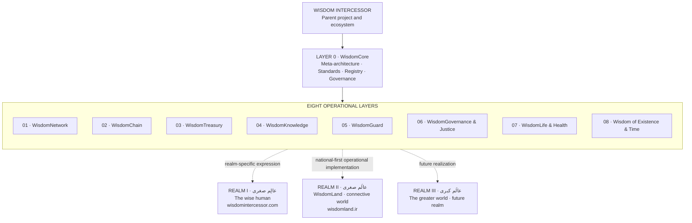

# Wisdom Intercessor

**حکمت برای همه، همه برای حکمت جاویدان**  
*A human-centered wisdom ecosystem built on three realms and a shared nine-layer architecture.*

Wisdom Intercessor is the parent project and ecosystem. Its architecture connects the wise human, the connective human-made world, and the greater world of existence through a shared framework of nine layers.

- **Parent platform:** [wisdomintercessor.com](https://wisdomintercessor.com)
- **Architecture authority:** [WisdomCore — Layer 0](https://github.com/Wisdom-Intercessor/WisdomCore)
- **Master architecture:** [WI-MA-002 — Three Realms, Nine-Layer Architecture](https://github.com/Wisdom-Intercessor/WisdomCore/blob/main/architecture/WISDOM-INTERCESSOR-THREE-REALMS-NINE-LAYER-MASTER-ARCHITECTURE-v1.0.md)
- **Visual and navigation standard:** [WI-UX-GH-001](https://github.com/Wisdom-Intercessor/WisdomCore/blob/main/docs/GITHUB-ORGANIZATION-VISUAL-ARCHITECTURE-WI-UX-GH-001.md)

## The nine-layer architecture

**Layer 0 is the meta-architectural authority. Layers 1–8 are the eight operational and foundational layer families.**

| Layer | System | Primary responsibility |
|---|---|---|
| 0 | **WisdomCore** | Meta-architecture, shared standards, registry and cross-realm coherence |
| 1 | **WisdomNetwork** | Communication, media, connection and participation |
| 2 | **WisdomChain** | Trust infrastructure, verifiable records and integrity |
| 3 | **WisdomTreasury** | Treasury, resource stewardship and economic infrastructure |
| 4 | **WisdomKnowledge** | Knowledge, research, learning and intelligence; WisdomAI is a subsystem |
| 5 | **WisdomGuard** | Security, protection and resilience |
| 6 | **WisdomGovernance & Justice** | Governance, justice, accountability and participation |
| 7 | **WisdomLife & Health** | Life, health and wellbeing |
| 8 | **Wisdom of Existence & Time** | Existence, Earth, cosmos and time |

## Three realms

1. **عالِم صغری — The wise human.** The human being as a conscious, responsible and wisdom-seeking agent. Wisdom Intercessor is its digital platform representation.
2. **عَالَم صغری — The connective small world.** WisdomLand connects people, institutions, knowledge, resources and systems. National implementation priority: [wisdomland.ir](https://wisdomland.ir). The international target [wisdomland.com](https://wisdomland.com) is future-facing and must not be represented as live unless verified.
3. **عَالَم کبری — The greater world.** Nature, Earth, living systems, physical reality, time and cosmos. This is a future realm; its dedicated infrastructure and governance require separate approval.

The nine-layer framework is shared across all three realms. Shared architecture does not mean identical software, duplicate deployments or simultaneous implementation.

## Domain and project distinction

- **WisdomLand — wisdomland.ir:** The official domain of Realm II within the Wisdom Intercessor ecosystem. Its architecture and repository remain under the Wisdom-Intercessor organization.
- **Wisland — wisland.ir:** A separate, independent commercial-social real-estate project. It is not an alternative name, domain alias, repository, or operational subsystem of WisdomLand.

The similarity of the names does not imply shared project ownership or interchangeable domains. Keep their documentation, repositories, product scope and public links distinct.

## Explore the ecosystem

- [WisdomCore](https://github.com/Wisdom-Intercessor/WisdomCore) — Layer 0 architecture authority.
- [WisdomChain](https://github.com/Wisdom-Intercessor/WisdomChain) — Layer 2 system workspace.
- [WisdomLand](https://github.com/Wisdom-Intercessor/WisdomLand) — connective-realm architecture and implementation workspace.
- [Wisdom-ID](https://github.com/Wisdom-Intercessor/Wisdom-ID) — shared identity capability; cross-layer classification.
- [WisdomPact](https://github.com/Wisdom-Intercessor/WisdomPact) — foundational pact and principles.
- [Eternal Wisdom Foundation](https://github.com/Wisdom-Intercessor/Eternal-Wisdom-Foundation) — foundation workspace.

This is a curated starting directory, not a complete or authoritative layer-to-repository registry. Repository classification must follow the canonical registry and verified ownership.

## Governance and maturity

Architecture approval, implementation progress and production operation are different states. A repository's existence or documentation does not prove that a service is deployed, secure, certified or operational.

Use explicit maturity labels: **Approved Architecture · Draft · In Design · In Development · Prototype · Pilot · Operational · Deferred · Future Realm**. Use Operational or Live only when supported by current evidence.

The shared architecture is governed by WisdomCore (Layer 0). Specialized operational systems retain responsibility for their own domain logic, data and services. Changes to architecture, repository ownership, visibility, domains and production deployments require their own traceable approvals.

## Participation

Read the repository-specific contribution and security guidance before contributing. Do not submit credentials, personal data, confidential information or production secrets to public issues or repositories.

---

**Wisdom Intercessor**  
*Wisdom for all; all for eternal wisdom.*
